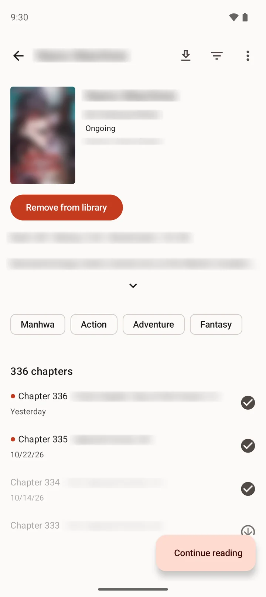
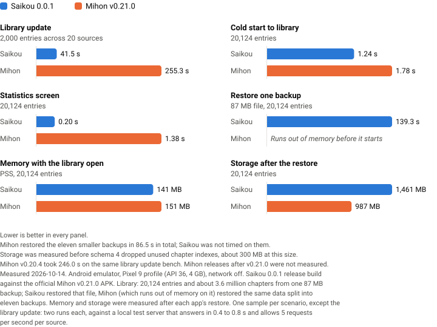

# Saikou

### Fast, private manga reader
Read manga, webtoons and comics from the extensions you choose, your own files and your downloads,
and keep your library in step across devices through your own Google Drive or WebDAV server.

[Website](https://shinsaikou.com) · [User guide](https://shinsaikou.com/docs/) · [Privacy policy](https://shinsaikou.com/privacy-policy)

## Download

*Requires Android 8.0 or higher on a 64-bit device (arm64 or x86_64).*

*Early release: expect rough edges, and back up your library before you try it.*

  <picture>
    <source media="(prefers-color-scheme: dark)" srcset=".github/assets/screenshots/library-dark.webp">
    
  </picture>
  
  
  

Screenshots of Saikou 0.0.1 on Android, with covers, titles and pages blurred.

## Features

* Third-party extensions built for the Tachiyomi extension API (lib 1.4 and 1.6), from the catalogs
  you add, with global search, pinned sources, multi-select and migration between sources.
* A reader with paged and long-strip (webtoon) modes, tall-strip splitting, animated images,
  double-page handling, page notes and crop borders.
* Local reading of CBZ, ZIP, CBR, RAR, CB7, 7z, CBT, TAR and EPUB files and folders of images.
* Categories with one level of sub-categories, filters, sorting, a fast search and per-entry edits
  of the title and description.
* Downloads as folders of pages, download ahead, automatic cleanup rules, and a copy of an existing
  downloads folder from a compatible reader.
* Sync of the library, categories, reading progress, history, bookmarks and tracking between
  devices, through Google Drive's private app folder or a WebDAV server you run.
* Tracker support: [MyAnimeList](https://myanimelist.net/) and [AniList](https://anilist.co/).
* Backup and restore in the `.tachibk` format, with a report of missing sources and trackers
  before anything is restored.
* Library updates, history, statistics, an app lock, a secure screen option and a choice of themes.
* Updates from this repository's releases: Saikou checks at most once a day, or when you tap Check
  for updates, and downloads one only when you tap Update.
* No telemetry, no crash reporting, no ads and no server of its own.

Saikou ships no extensions and no catalog. Add a catalog you trust in **Browse > Extensions**, or
restore a backup that already names one. Extensions are third-party code that runs inside the app,
so only install ones you trust.

## How it compares

The same 20,124-entry library and the same steps, timed on the same Android emulator: Saikou 0.0.1
against Mihon v0.21.0, the reader most people come from. Lower is better in every panel, and the
one place Saikou loses, storage, stays in.

<picture>
  <source media="(prefers-color-scheme: dark)" srcset=".github/assets/comparison-dark.svg">
  
</picture>

The numbers as a table

| Measurement | Saikou 0.0.1 | Mihon v0.21.0 |
|---|---|---|
| Library update, 2,000 entries across 20 sources | 41.5 s | 255.3 s |
| Cold start to library content, 20,124 entries | 1.24 s | 1.78 s |
| Statistics screen, 20,124 entries | 0.20 s | 1.38 s |
| Restore one 87 MB backup, 20,124 entries | 139.3 s | runs out of memory before it starts |
| Memory with the library open (PSS) | 141 MB | 151 MB |
| Storage after the restore | 1,461 MB | 987 MB |

Measured 2026-10-14 on an Android emulator (Pixel 9 profile, API 36, 4 GB) with the network off,
against the official Mihon v0.21.0 APK. Saikou restored one 87 MB backup holding the 20,124 entries.
Mihon runs out of memory on that file, so it restored the same data split into eleven backups, in
86.5 s in total (Saikou was not timed on those). Memory and storage were
measured after each app's restore. One sample per scenario except the library update (two runs each,
against a local test server that answers in 0.4 to 0.8 s and allows 5 requests per second per
source). Storage was measured before schema 4 dropped unused chapter indexes, about 300 MB at this
size. Mihon v0.20.4 took 246.0 s on the same library update bench; Mihon releases after v0.21.0 were
not measured. The chart is drawn from `tools/charts/comparison.json` by
`python3 tools/charts/comparison.py .github/assets`.

Next to other readers:

| | Saikou | Mihon | Komikku | TachiyomiSY | Mangayomi | Aidoku |
|---|---|---|---|---|---|---|
| Platforms | Android | Android | Android | Android | Android, iOS, Windows, macOS, Linux | iOS, iPadOS, macOS |
| Reads Tachiyomi extensions | Yes, lib 1.4 and 1.6 | Yes | Yes | Yes | Yes, one of several engines | No, its own sources |
| Sync between devices | Built in: Google Drive or WebDAV | No | Google Drive, WebDAV or a SyncYomi server | Google Drive or a SyncYomi server | A self-hosted sync server | iCloud |
| License | Apache-2.0 | Apache-2.0 | Apache-2.0 | Apache-2.0 | Apache-2.0 | GPL-3.0 |
| Latest release | 0.1.0, 2026-11-01 | v0.21.3, 2026-10-25 | v1.14.1, 2026-07-17 | 1.13.2, 2026-07-13 | v0.9.9, 2026-10-12 | v0.9-4, 2026-10-16 |

Features as each project documents them (checked 2026-09-10); licenses and releases read from
each project's GitHub repository on 2026-10-30.

## Contributing

[Code of conduct](./CODE_OF_CONDUCT.md) · [Contributing guide](./CONTRIBUTING.md) · [Security policy](./SECURITY.md)

Pull requests are welcome. For major changes, please open an issue first to discuss what you would like to change.

Before reporting a new issue, take a look at the [FAQ](https://shinsaikou.com/docs/faq), the [changelog](./CHANGELOG.md) and the already opened [issues](https://github.com/ShinSaikou/saikou/issues); if you have any questions, join our [Discord server](https://discord.gg/VupfVKYquZ). Report security problems privately, as the security policy describes, not in a public issue.

### Repositories

### Credits

Saikou is built on [Mihon](https://github.com/mihonapp/mihon) and the Tachiyomi project before it. Thank you to everyone who made them.

### Disclaimer

The developer of this application does not have any affiliation with the content providers available, and this application hosts zero content. Extensions and the sources they read are maintained by third parties.

### License

<pre>
Copyright © 2015 Javier Tomás
Copyright © 2024 Mihon Open Source Project
Copyright © 2026 The Saikou authors

Licensed under the Apache License, Version 2.0 (the "License");
you may not use this file except in compliance with the License.
You may obtain a copy of the License at

http://www.apache.org/licenses/LICENSE-2.0

Unless required by applicable law or agreed to in writing, software
distributed under the License is distributed on an "AS IS" BASIS,
WITHOUT WARRANTIES OR CONDITIONS OF ANY KIND, either express or implied.
See the License for the specific language governing permissions and
limitations under the License.
</pre>

Saikou includes code from other projects under their own licenses; [NOTICE](NOTICE) lists them.

